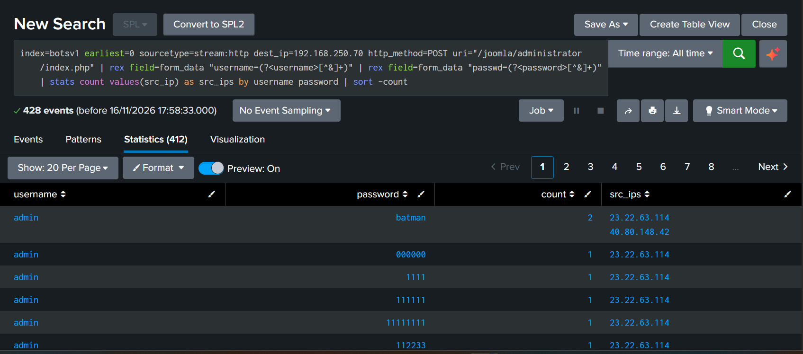
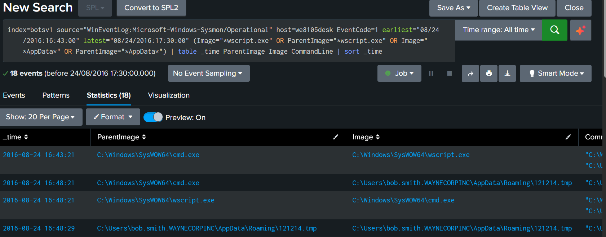
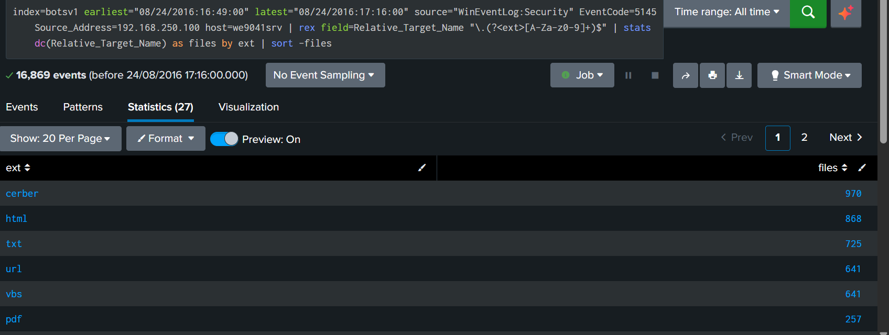
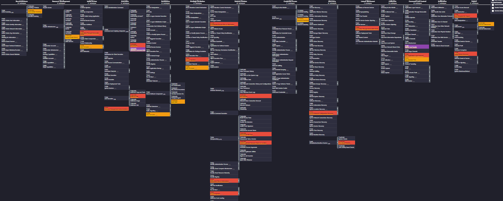

# Splunk Incident Investigation: Boss of the SOC v1

An end-to-end SOC investigation of two attacks against the fictional company **Wayne Enterprises**, using Splunk's free [BOTS v1 dataset](https://github.com/splunk/botsv1) (33 million real log events). I investigated both scenarios from raw logs to a written incident report, mapped the attacks to MITRE ATT&CK, and wrote detection searches that would have caught them.

📄 **[Read the incident report](report/incident-report.md)** · 🔎 **[See every SPL query and why I ran it](queries.md)** · 🗺️ **[ATT&CK Navigator layer](attack-navigator/bots-v1-layer.json)**

---

## What I found

### Scenario 1: Web defacement (High)
- An **Acunetix** vulnerability scan against `imreallynotbatman.com`, confirmed in both web traffic and IDS alerts
- A **Python brute-force** script guessed the Joomla admin password (`batman`) after 412 attempts
- The attacker logged in, uploaded a **web shell** (`agent.php`) and a **Meterpreter backdoor** (`3791.exe`, 63/68 on VirusTotal)
- Traced the process chain `php-cgi.exe → cmd.exe → 3791.exe` and its C2 connection to `23.22.63.114:3791`
- Found the **defacement image** the server downloaded from the attacker's domain

### Scenario 2: Cerber ransomware (Critical)
- Patient zero: **bob.smith** on **we8105desk** opened `Miranda_Tate_unveiled.dotm` from a **USB drive**
- Followed the full chain: **macro → cmd.exe → obfuscated VBScript → payload download → Cerber**
- Documented defense evasion: payload disguised as `.jpg`, masquerading as `osk.exe`, sandbox sleep loops, self-deletion
- Found **shadow copy deletion** and **recovery disabled** before encryption
- Proved spread to file server **we9041srv**: 38,398 SMB events, **970 files encrypted**, ransom notes in **641 folders**

**24 MITRE ATT&CK techniques** mapped across both scenarios.

---

## Skills demonstrated

| Skill | Where to see it |
|---|---|
| SPL query writing (`stats`, `tstats`, `rex`, `rename`, `convert`, `bin`, time windows, `NOT` filtering) | [queries.md](queries.md) |
| Pivoting across log sources (web, DNS, IDS, firewall, Sysmon, Windows Security, SMB) | Q8, Q18, Q25–Q31 |
| Building an incident timeline | [Report §3](report/incident-report.md#3-timeline) |
| Threat intelligence enrichment (VirusTotal) | [Report §5](report/incident-report.md#5-indicators-of-compromise-iocs) |
| MITRE ATT&CK mapping | [Report §6](report/incident-report.md#6-mitre-attck-mapping) + Navigator layer |
| Separating benign activity from malicious (Nessus scans, Joomla updates) | Q16, Q22–Q23 |
| Troubleshooting a SIEM (sourcetype renaming, field-name quirks, time zones) | [queries.md §3](queries.md#3-dead-ends-and-lessons) |
| Writing detections | [queries.md §4](queries.md#4-detection-ideas-searches-that-could-become-alerts) |
| Severity assessment and containment / remediation | [Report §7–9](report/incident-report.md#7-severity-assessment) |

---

## Tools

- **Splunk Enterprise 10.6** on Ubuntu (WSL2), SPL
- **VirusTotal**: hash, IP and domain reputation
- **MITRE ATT&CK Navigator**: technique mapping

---

## Key screenshots

| | |
|---|---|
|  |  |
| *412 passwords tried; only `batman` used by both attacker IPs* | *Ransomware process chain on bob.smith's workstation* |
|  |  |
| *970 `.cerber` files on the file server* | *ATT&CK techniques (orange = defacement, red = ransomware, purple = both)* |

More evidence for each query is in [`screenshots/evidence/`](screenshots/evidence/).

---

## Repository structure

```
├── README.md
├── queries.md                     # every SPL search, why I ran it, what it showed
├── report/
│   └── incident-report.md         # full incident report
├── attack-navigator/
│   └── bots-v1-layer.json         # import into ATT&CK Navigator
└── screenshots/
    ├── 01-data-loaded.png ... 07-attack-navigator.png   # used in the report
    └── evidence/                  # supporting screenshots for queries.md
```

---

## How to reproduce

1. Install **Splunk Enterprise** (I used 10.6 on Ubuntu in WSL2). Run it as a normal user, not root.
2. Download the pre-indexed dataset from [github.com/splunk/botsv1](https://github.com/splunk/botsv1) and extract it into `$SPLUNK_HOME/etc/apps/`, then restart Splunk.
3. Install the add-ons from Splunkbase: Microsoft Windows, Sysmon, Stream Wire Data, Fortinet FortiGate, Suricata. (Tenable and URL Toolbox are not compatible with Splunk 10 and were skipped; `rex` replaces URL Toolbox.)
4. Set your Splunk user **time zone to UTC** (Administrator → Preferences).
5. **Note:** modern add-ons rename some sourcetypes at search time. Use `| tstats count where index=botsv1 by sourcetype source` to see the original names, and search Sysmon with `source="WinEventLog:Microsoft-Windows-Sysmon/Operational"`.
6. Every search in [queries.md](queries.md) uses `earliest=0` or an explicit time window, so it runs regardless of the time picker.

---

## Lessons learned

- **Check the data before trusting a 0-result search.** The data was there; the add-ons had renamed it.
- **A field matching an IP doesn't mean the log came from that machine.** Receiving servers log the source IP too.
- **Filter known-good first.** Nessus scans and Joomla update checks were noise that had to be ruled out.
- **IP reputation expires, hashes don't.** The 2016 attacker IPs look clean today; the malware hashes are still flagged.
- **Be precise about impact.** 5,193 files were *accessed*; 970 were *encrypted*. The report states both.

---

*Dataset: Splunk Boss of the SOC v1, publicly released by Splunk. All company names, users and systems are fictional.*
