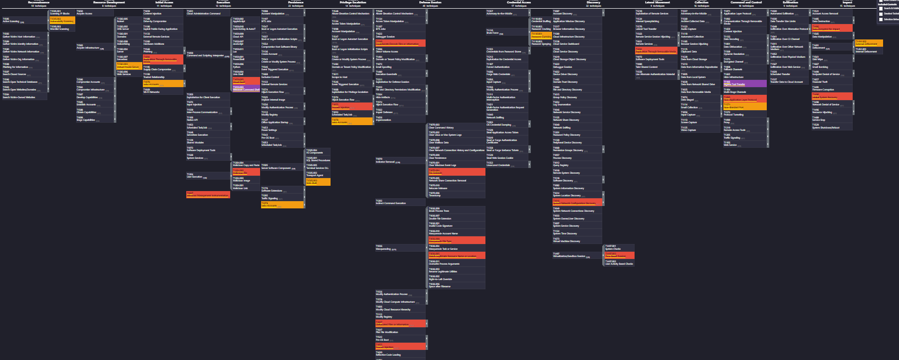
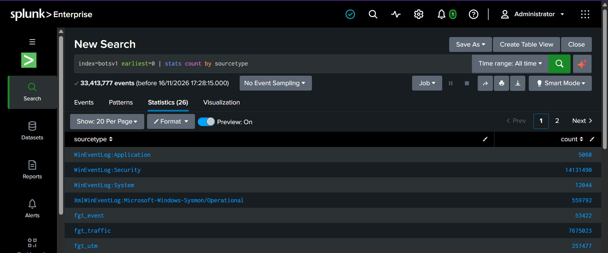
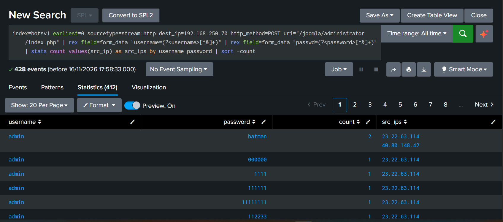
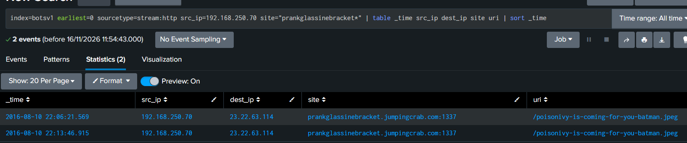
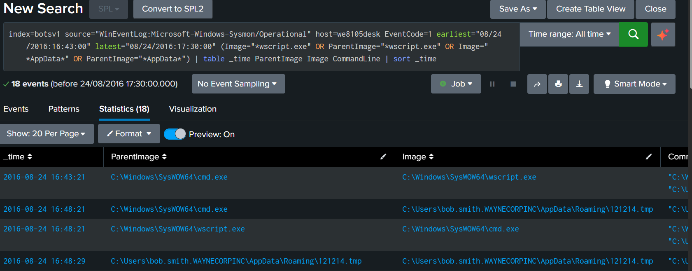
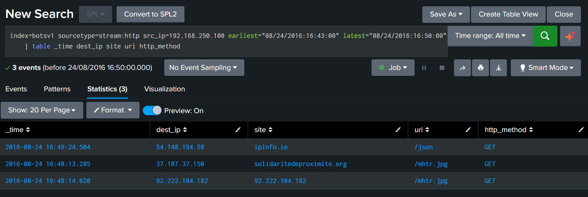
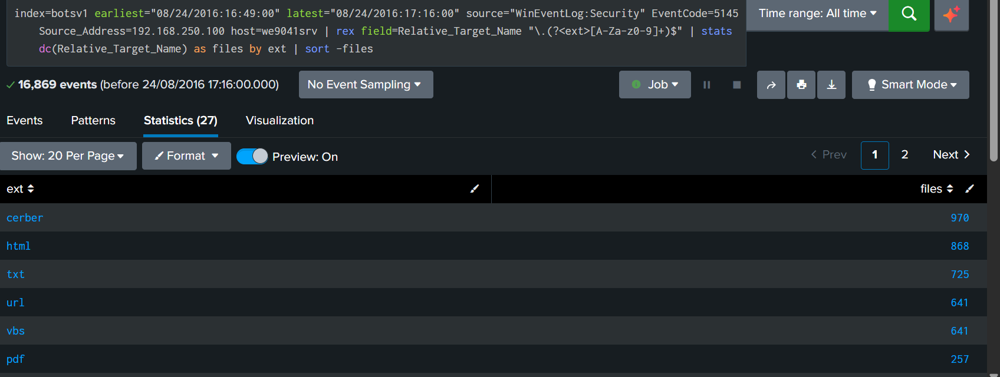

# Incident Report: Wayne Enterprises (Splunk BOTS v1)

| | |
|---|---|
| **Analyst** | Halima Abdirizak Mohamed |
| **Report date** | 16-11-2026 |
| **Incidents covered** | (1) Web defacement of imreallynotbatman.com, (2) Cerber ransomware infection |
| **Incident windows (UTC)** | 2016-08-10 21:36 – 22:23 (defacement) · 2016-08-24 16:43 – 17:16 (ransomware) |
| **Data source** | Splunk Boss of the SOC v1 dataset, `index=botsv1` (33,413,777 events, 26 sourcetypes) |
| **Overall severity** | **Critical** |

---

## 1. Executive summary

**Website defacement (10 August 2016).** An attacker scanned the company's public website, imreallynotbatman.com, for weaknesses and then used an automated script to guess the administrator password. After 412 attempts the password `batman` worked. The attacker logged in, uploaded a backdoor program and a web shell, took remote control of the web server, and replaced the website's content with an image reading "poisonivy is coming for you batman". The whole attack took about 45 minutes. Customers visiting the site would have seen the defacement.

**Ransomware (24 August 2016).** Employee Bob Smith opened a Word document from a USB drive. A hidden macro downloaded and ran Cerber ransomware, which deleted the computer's backups, disabled Windows recovery, and encrypted files both on Bob's PC and on a shared company file server. 970 files on the file server were encrypted and ransom notes were left in 641 folders. Shared company data was locked and local recovery options were destroyed.

**Top recommendation:** enforce strong, unique passwords with multi-factor authentication on all admin panels, block Office macros from untrusted sources, and keep offline backups of file servers.

---

## 2. Scope and method

- **Log sources used:** `stream:http`, `stream:dns`, `stream:smb`, `suricata`, `fortigate_traffic` / `fortigate_utm`, Sysmon (`WinEventLog:Microsoft-Windows-Sysmon/Operational`), Windows Security (`WinEventLog:Security`)
- **Tools:** Splunk Enterprise 10.6 (SPL), VirusTotal, MITRE ATT&CK Navigator
- **Time zone:** all times are **UTC** (Splunk user time zone set to UTC before the timeline was built)
- **Full query log:** [`queries.md`](../queries.md), with every search, the reason it was run and what it showed
- **Environment notes:**
  - Modern Splunk add-ons rename some original sourcetypes at search time (e.g. `fgt_traffic` → `fortigate_traffic`, Sysmon → `XmlWinEventLog`). Searches use `source=` where needed. `| tstats` was used to see the original index-time names.
  - Authorised Nessus/Tenable scanning activity on we8105desk (WMI-launched `netstat`, `tasklist`, `netsh`, `nessus_*.TMP` files) was identified as benign and filtered out.

---

## 3. Timeline

### 3.1 Scenario 1: Web defacement (2016-08-10, UTC)

| Time | Source / Host | Event | Evidence |
|---|---|---|---|
| 21:36:45 | 40.80.148.42 | Acunetix vulnerability scan begins against imreallynotbatman.com (192.168.250.70) | stream:http, suricata ("ET SCAN Acunetix Version 6") |
| 21:45:09 | 23.22.63.114 | Brute force against Joomla admin login begins (`Python-urllib/2.7`) | stream:http |
| 21:46:33 | 23.22.63.114 | Brute force submits the working password `batman` (412 unique passwords tried) | stream:http `form_data` |
| 21:48:05 | 40.80.148.42 | Attacker logs in as `admin` with `batman` using Internet Explorer 11 | stream:http `http_user_agent` |
| 21:52:47 | 40.80.148.42 | Uploads `3791.exe` (Meterpreter) and `agent.php` (web shell) | stream:http `part_filename{}` |
| 21:56:18 | we1149srv | `php-cgi.exe` → `cmd.exe /c 3791.exe` → `3791.exe` executes | Sysmon EventCode 1 |
| 21:56:19 | we1149srv | `3791.exe` connects to C2 at 23.22.63.114:3791 | Sysmon EventCode 3 |
| 21:58:23 | we1149srv | `3791.exe` spawns `cmd.exe` (interactive remote shell) | Sysmon EventCode 1 |
| 22:06:21 | we1149srv | Web server downloads `poisonivy-is-coming-for-you-batman.jpeg` from prankglassinebracket.jumpingcrab.com:1337 | stream:http |
| 22:08:13 | we1149srv | `3791.exe` spawns `cmd.exe` again | Sysmon EventCode 1 |
| 22:13:46 | we1149srv | Defacement image downloaded a second time | stream:http |
| 22:21:34 | 23.22.63.114 | Last activity from 23.22.63.114 (web shell use: 194 requests to `/joomla/agent.php`) | stream:http |
| 22:22:27 | 40.80.148.42 | Last activity from 40.80.148.42 | stream:http |

### 3.2 Scenario 2: Cerber ransomware (2016-08-24, UTC)

| Time | Host | Event | Evidence |
|---|---|---|---|
| 16:43:12 | we8105desk | bob.smith opens `D:\Miranda_Tate_unveiled.dotm` (removable drive) in Word | Sysmon EventCode 1 |
| 16:43:21 | we8105desk | Macro: `WINWORD.EXE` → `cmd.exe` writes obfuscated VBScript and runs `wscript.exe ...\AppData\Roaming\20429.vbs` | Sysmon EventCode 1 |
| 16:48:13 | we8105desk | Downloads `/mhtr.jpg` from solidaritedeproximite.org (37.187.37.150) | stream:http |
| 16:48:14 | we8105desk | Requests `/mhtr.jpg` from fallback address 92.222.104.182 | stream:http |
| 16:48:21 | we8105desk | Decoded payload `121214.tmp` (Cerber) executes | Sysmon EventCode 1 |
| 16:48:41 | we8105desk | Copies itself to `AppData\Roaming\{35ACA89F-933F-6A5D-2776-A3589FB99832}\osk.exe`; deletes `121214.tmp` | Sysmon EventCode 1 |
| 16:49:01 | we8105desk | `osk.exe` launches `explorer.exe` (likely process injection) | Sysmon EventCode 1 |
| 16:49:23 | we8105desk | Shadow copies deleted: `wmic shadowcopy delete`, `vssadmin delete shadows /all /quiet` | Sysmon EventCode 1 |
| 16:49:24 | we8105desk | Recovery disabled: `bcdedit /set {default} recoveryenabled no` and `bootstatuspolicy ignoreallfailures` | Sysmon EventCode 1 |
| 16:49:24 | we8105desk | Cerber check-in to 85.93.0.0/16; external IP lookup to ipinfo.io/json | suricata ("ETPRO TROJAN Ransomware/Cerber Checkin 2"), stream:http |
| 16:49 – 17:15 | we8105desk → we9041srv | Mass file access over SMB (38,398 SMB events on port 445); 5,193 unique files touched; 970 encrypted | stream:smb, WinEventLog:Security EventCode 5145 |
| 17:15:11 | we8105desk | Ransom note `# DECRYPT MY FILES #.txt` opened in Notepad; Internet Explorer launched | Sysmon EventCode 1 |
| 17:15:12 | we8105desk | `# DECRYPT MY FILES #.vbs` runs; `.onion` payment domain lookup | Sysmon EventCode 1, suricata |
| 17:15:29 | we8105desk | Ransomware self-deletes (`taskkill` + `del osk.exe`) | Sysmon EventCode 1 |

---

## 4. Affected hosts

| Hostname | IP | Role | User | Impact |
|---|---|---|---|---|
| we1149srv | 192.168.250.70 | Public web server (IIS + Joomla) hosting imreallynotbatman.com | n/a | Admin account compromised, web shell and Meterpreter backdoor installed, site defaced |
| we8105desk | 192.168.250.100 | Employee workstation | WAYNECORPINC\bob.smith | Cerber ransomware executed, local files encrypted, shadow copies deleted, recovery disabled |
| we9041srv | 192.168.250.20 | File server (also answered DNS/LDAP; likely domain controller) | n/a | 970 files on network share encrypted; ransom notes in 641 folders |

---

## 5. Indicators of compromise (IOCs)

| Type | Value | Context | VirusTotal | Scenario |
|---|---|---|---|---|
| IP | 40.80.148.42 | Acunetix scanner, admin login, file upload (Microsoft Azure, AS8075) | 1/92 | 1 |
| IP | 23.22.63.114 | Brute force, web shell use, C2, defacement host (Amazon AWS, AS14618) | 0/92 | 1 |
| IP:Port | 23.22.63.114:3791 | Meterpreter command-and-control | n/a | 1 |
| Domain | prankglassinebracket.jumpingcrab.com | Hosted defacement image on port 1337 | 3/92 | 1 |
| File | 3791.exe | Meterpreter backdoor (trojanized ApacheBench `ab.exe`) | 63/68 | 1 |
| MD5 | AAE3F5A29935E6ABCC2C2754D12A9AF0 | 3791.exe | 63/68 (`trojan.swrort/cryptz`) | 1 |
| SHA256 | EC78C938D8453739CA2A370B9C275971EC46CAF6E479DE2B2D04E97CC47FA45D | 3791.exe | 63/68 | 1 |
| File | agent.php | Web shell uploaded to Joomla | n/a | 1 |
| File | poisonivy-is-coming-for-you-batman.jpeg | Defacement image | n/a | 1 |
| Credential | admin / batman | Compromised Joomla administrator account | n/a | 1 |
| File | Miranda_Tate_unveiled.dotm | Malicious macro-enabled Word template (USB) | n/a | 2 |
| File | 20429.vbs | Obfuscated VBScript downloader | n/a | 2 |
| Domain | solidaritedeproximite.org | Payload download host (likely compromised legitimate site, OVH) | 0/92 | 2 |
| IP | 37.187.37.150 | solidaritedeproximite.org | n/a | 2 |
| IP | 92.222.104.182 | Fallback payload download | n/a | 2 |
| URL | /mhtr.jpg | Encoded ransomware payload disguised as image | n/a | 2 |
| File | 121214.tmp / osk.exe | Cerber ransomware (VirusTotal also lists it as chkdsk.exe) | 55/71 | 2 |
| MD5 | EE0828A4E4C195D97313BFC7D4B531F1 | Cerber payload | 55/71 (`trojan.cerber/fimal`) | 2 |
| SHA256 | 37397F8D8E4B3731749094D7B7CD2CF56CACB12DD69E0131F07DD78DFF6F262B | Cerber payload | 55/71 | 2 |
| Path | %APPDATA%\\{35ACA89F-933F-6A5D-2776-A3589FB99832}\\osk.exe | Ransomware masquerading location | n/a | 2 |
| Network | 85.93.0.0/16 | Cerber UDP check-in range | n/a | 2 |
| File | # DECRYPT MY FILES #.txt / .html / .url / .vbs | Ransom notes | n/a | 2 |
| Extension | .cerber | Encrypted file extension | n/a | 2 |

> **Note on reputation:** the attacker IPs and domains score low today because they are 2016 cloud and hosting infrastructure that has since been reassigned. IP and domain IOCs age quickly; the file hashes remain reliable.

---

## 6. MITRE ATT&CK mapping

| Tactic | Technique ID | Technique name | How it was observed | Scenario |
|---|---|---|---|---|
| Resource Development | T1583.003 | Acquire Infrastructure: Virtual Private Server | Attacker IPs on Azure and AWS | 1 |
| Reconnaissance | T1595.002 | Active Scanning: Vulnerability Scanning | Acunetix scan from 40.80.148.42 | 1 |
| Credential Access | T1110.001 | Brute Force: Password Guessing | 412 password attempts from Python script | 1 |
| Initial Access | T1078 | Valid Accounts | Login as Joomla `admin` with guessed password | 1 |
| Persistence | T1505.003 | Server Software Component: Web Shell | `agent.php` uploaded and used | 1 |
| Execution | T1059.003 | Command and Scripting Interpreter: Windows Command Shell | php-cgi → cmd.exe; WINWORD → cmd.exe | 1, 2 |
| Command and Control | T1105 | Ingress Tool Transfer | 3791.exe upload, image download; mhtr.jpg download | 1, 2 |
| Command and Control | T1571 | Non-Standard Port | C2 on 3791, image served on 1337 | 1 |
| Impact | T1491.002 | Defacement: External Defacement | Website replaced with attacker image | 1 |
| Initial Access | T1091 | Replication Through Removable Media | Document opened from `D:\`; closest available match | 2 |
| Execution | T1204.002 | User Execution: Malicious File | bob.smith opened the .dotm | 2 |
| Execution | T1059.005 | Command and Scripting Interpreter: Visual Basic | Macro and `20429.vbs` | 2 |
| Execution | T1047 | Windows Management Instrumentation | `wmic shadowcopy delete` | 2 |
| Defense Evasion | T1027 | Obfuscated Files or Information | Encoded strings and junk arithmetic in VBS | 2 |
| Defense Evasion | T1497.003 | Virtualization/Sandbox Evasion: Time Based Evasion | Sleep loops, ~5-minute delay before download | 2 |
| Defense Evasion | T1140 | Deobfuscate/Decode Files or Information | XOR decoding of mhtr.jpg into 121214.tmp | 2 |
| Defense Evasion | T1036.005 | Masquerading: Match Legitimate Name or Location | Copied to `osk.exe` | 2 |
| Defense Evasion | T1036.008 | Masquerading: Masquerade File Type | Executable payload named `.jpg` | 2 |
| Defense Evasion | T1055 | Process Injection (likely) | osk.exe launched explorer.exe; injection not directly observed | 2 |
| Defense Evasion | T1070.004 | Indicator Removal: File Deletion | Self-deletion of 121214.tmp and osk.exe | 2 |
| Command and Control | T1095 | Non-Application Layer Protocol | UDP check-in to 85.93.0.0/16 | 2 |
| Discovery | T1016 | System Network Configuration Discovery | ipinfo.io/json external IP lookup | 2 |
| Impact | T1490 | Inhibit System Recovery | vssadmin, wmic, bcdedit | 2 |
| Impact | T1486 | Data Encrypted for Impact | 970 `.cerber` files on we9041srv | 2 |

ATT&CK Navigator layer: [`attack-navigator/bots-v1-layer.json`](../attack-navigator/bots-v1-layer.json)

---

## 7. Severity assessment

### Scenario 1: Web defacement: **High**
- **Integrity:** the public website was altered and the attacker had full command execution on the server.
- **Confidentiality:** a Meterpreter backdoor gave interactive remote access; any data on we1149srv must be considered exposed.
- **Availability / reputation:** customers saw the defaced site, which damages trust.
- **Scope:** one internet-facing server. No spread to internal hosts was observed in this investigation.
- **Why not Critical:** no data destruction, and the scope was limited to one server.

### Scenario 2: Ransomware: **Critical**
- **Availability:** company data on a shared file server was encrypted, so multiple users lose access to their files.
- **Recoverability:** shadow copies were deleted and Windows recovery was disabled, so local restore is not possible.
- **Scope:** two hosts, including a central server (we9041srv) that also served DNS and LDAP.
- **Business impact:** 970 encrypted files across 641 folders means operational disruption until restored from backup.

**Overall incident severity: Critical**, driven by the ransomware's impact on shared business data and its destruction of recovery options.

---

## 8. Containment (immediate actions)

**Web defacement**
1. Take imreallynotbatman.com offline or show a maintenance page; isolate we1149srv from the network.
2. Block 40.80.148.42, 23.22.63.114 and prankglassinebracket.jumpingcrab.com at the firewall.
3. Disable and reset the Joomla `admin` account and all other Joomla accounts.
4. Remove `agent.php` and `3791.exe`; kill any `3791.exe` processes; preserve copies for forensics first.
5. Check all other servers for connections to 23.22.63.114:3791.

**Ransomware**
1. Isolate we8105desk and we9041srv from the network immediately.
2. Disable or reset bob.smith's account and revoke active sessions.
3. Block solidaritedeproximite.org, 37.187.37.150, 92.222.104.182 and 85.93.0.0/16.
4. Hunt across all endpoints for the Cerber hash (`EE0828A4E4C195D97313BFC7D4B531F1`), `.cerber` files and `# DECRYPT MY FILES #` notes.
5. Make the affected file shares read-only until restoration is complete.
6. Seize and quarantine the USB drive.

## 9. Remediation (longer-term fixes)

1. **Rebuild we1149srv** from a clean image; patch IIS, PHP and Joomla to current versions.
2. **Enforce strong passwords and MFA** on all web admin panels; restrict `/administrator` to internal or VPN IP addresses.
3. **Add login rate-limiting / account lockout** to stop brute force.
4. **Deploy a web application firewall (WAF)** to block scanner payloads (SQLi, XSS, command injection).
5. **Block executable uploads** in the CMS and prevent the web server process from spawning `cmd.exe`.
6. **Restore we9041srv data from offline backups**; reimage we8105desk.
7. **Keep offline / immutable backups** that ransomware cannot delete.
8. **Disable Office macros** from the internet and from removable media via Group Policy.
9. **Restrict or block USB storage** on workstations.
10. **Deploy EDR** that blocks shadow-copy deletion and Office applications spawning script engines.
11. **Apply least privilege to file shares**: users should only have write access where needed.
12. **Security awareness training** on opening unknown files, especially from USB drives.

---

## 10. Lessons learned and detection opportunities

**Gaps observed**
- No alerting on high-volume failed admin logins from a single IP.
- No alerting when a web server process spawned a command shell.
- No control preventing Office from launching scripts.
- No alerting on shadow-copy deletion, a strong ransomware signal.
- File share access had no anomaly detection (38,398 SMB events in 27 minutes went unnoticed).

**Proposed detections** (full SPL in [`queries.md`](../queries.md), section 4)
- **D1:** brute force against CMS login pages (more than 20 POSTs to an admin login in 5 minutes from one IP)
- **D2:** web server process spawning `cmd.exe` or `powershell.exe`
- **D3:** Office application spawning `cmd.exe`, `wscript.exe` or `powershell.exe`
- **D4:** shadow copy deletion or recovery disabling
- **D5:** one host accessing an unusually high number of unique files on a share

---

## Appendix: Evidence screenshots

**Figure 1: BOTS v1 data loaded (33,413,777 events across 26 sourcetypes)**

**Figure 2: Brute-force passwords. Only `batman` was used by both attacker IPs.**

**Figure 3: Web server downloading the defacement image from the attacker domain**

**Figure 4: Ransomware process chain on we8105desk**

**Figure 5: Payload download from solidaritedeproximite.org**

**Figure 6: File types on we9041srv. 970 files carry the `.cerber` extension.**

